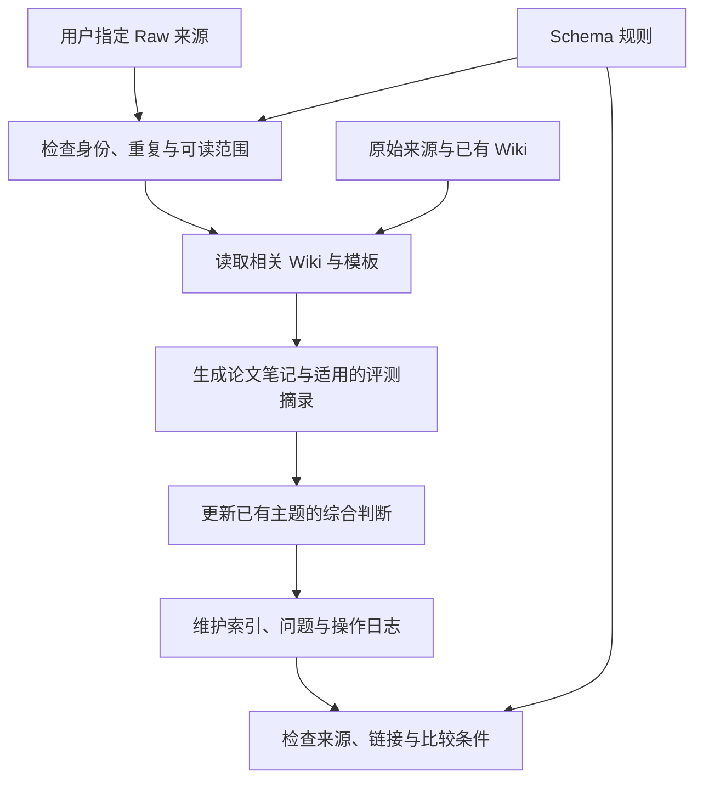

# 科研知识库使用总览

本项目用 Codex 将用户选择的来源整理为可追溯的 Wiki，并随新来源更新已有主题判断。设计参考 Karpathy 的 [LLM Wiki](https://gist.github.com/karpathy/442a6bf555914893e9891c11519de94f)：原始材料、持续积累的 Wiki，以及约束维护行为的 Schema。

## 目录与职责

```text
AGENTS.md           Codex 项目入口与任务路由
Raw/                用户选择的论文、仓库链接、笔记、研究问题与计划
Schema/             内容约定、工作流程、质量标准
templates/          paper、benchmark、topic、questions、Progress 页面模板
Wiki/               论文笔记、作者评测摘录、跨论文主题、问题与进度
  index.md          内容导航与来源处理状态
log/operations.md   追加式操作记录
```

已有 Raw 来源由 Codex 只读使用；补充或修订以明确授权的新材料追加。Wiki 的重要判断能回到具体来源，用户观点、作者报告与 Codex 推断分别标明。`Demo/` 排除在项目工作范围之外。

Schema 负责行为规则，模板负责页面结构，各目录 README 负责用途和导航。完整规则只在 [内容约定](Schema/conventions.md)、[工作流程](Schema/workflows.md)、[质量标准](Schema/quality.md) 中维护。插件或 skill 不会因放进 Schema 就自动启用，本阶段通过 Markdown 和文件搜索工作。

## 从哪里启动

实际 Git 根目录是 `D:\RS-AutoReaserch-Konwledge-Base\RS-AutoReasearch-Knowledge-Base`。在 Codex 中打开此目录，或从 PowerShell 启动：

```powershell
codex --cd 'D:\RS-AutoReaserch-Konwledge-Base\RS-AutoReasearch-Knowledge-Base'
```

根目录的 [AGENTS.md](AGENTS.md) 引导 Codex 按任务读取 Schema。Codex 按项目根到当前工作目录发现指令，不会从根目录启动时自动读取所有子目录中的同名文件，参见 [官方加载规则](https://learn.chatgpt.com/docs/agent-configuration/agents-md)。外层工作区另有简短转发入口，兼容仍从父目录启动的会话；未修改全局配置或应用项目设置。

## 一次入库如何完成



完成要求见 [工作流程](Schema/workflows.md)：正文有证据，相关主题已检查，索引与日志一致，问题和未完成部分明确。部分失败可以从已有产物继续；空来源不会被写成完整论文总结。

## 日常请求示例

- **入库：**“将 Raw 中指定的论文按规范入库，并检查其对现有相关主题的影响。”仅处理指定范围，不自动批量处理其他来源。
- **问答：**“根据现有 Wiki 比较这两篇论文的假设与证据。”默认只读，不写入任何索引、问题或日志。
- **保存：**“将刚才的比较保存到相关主题页。”保存时保留来源、更新索引并记日志。
- **健康检查：**“检查 Wiki 的断链、无证据结论和来源冲突，只报告问题。”明确要求修复后才写入。
- **进度：**“根据指定计划和实际产物更新今天的 Wiki 进度。”不覆盖 Raw 中的原始计划。

benchmark 仅整理作者报告的实验。不同数据集、划分、指标或关键条件的结果分别展示，说明比较限制；不运行代码或将作者结果称为本项目实测。

## 当前起点

从 [Wiki 索引](Wiki/index.md) 浏览已入库知识，从 [操作日志](log/operations.md) 了解实际变更。原有四个空来源仅作占位，不构成已阅读或已入库证据；旧命名兼容关系见 [Raw 说明](Raw/README.md)。真实资料应在用户指定来源后处理。
